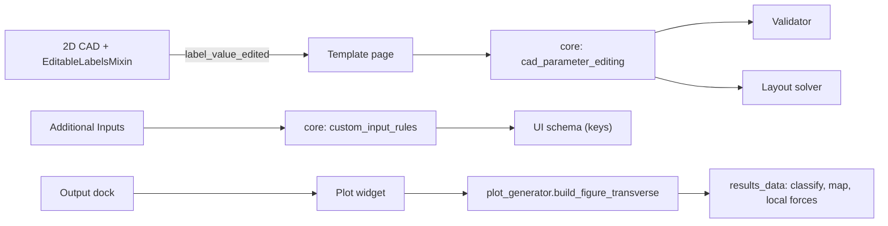
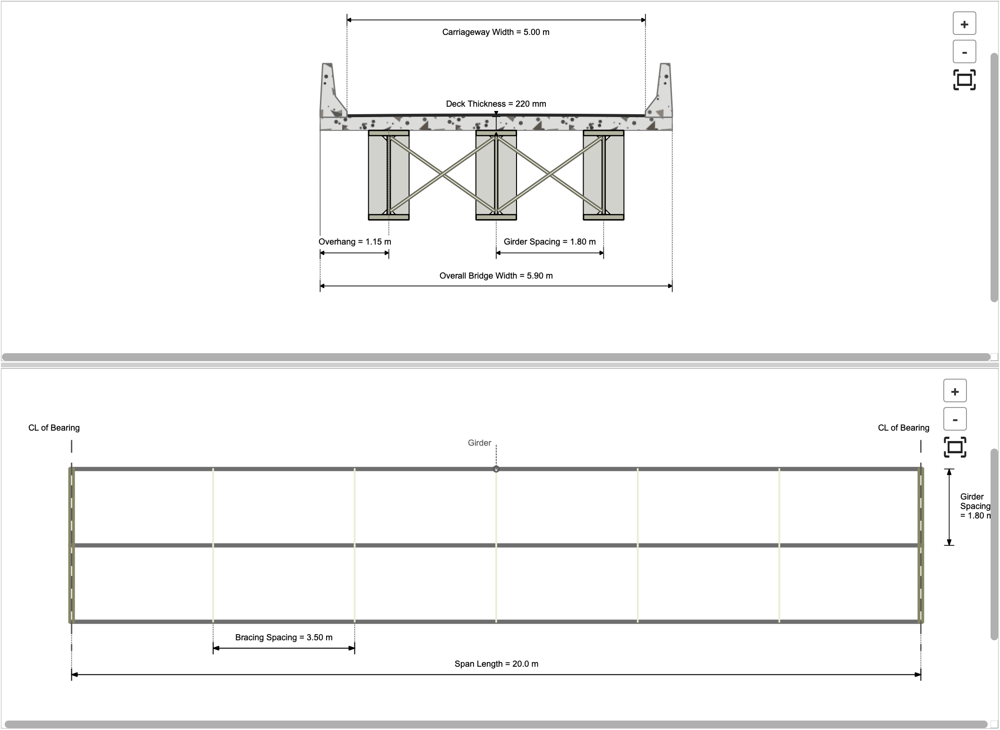
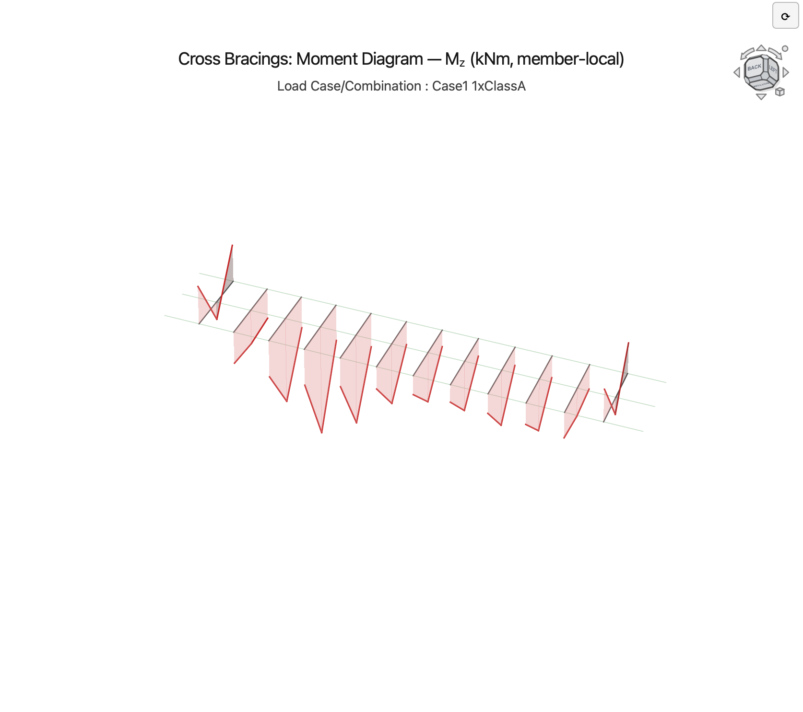

# OsdagBridge — UI, 2D CAD and Transverse-Member Plotting Enhancements

FOSSEE Osdag Winter Internship 2026 screening task: in-place editing on the 2D CAD, safe
Save/Close in Additional Inputs, and result plots for end diaphragms and cross-bracing.

**Report:** [`report/final_research_report.md`](report/final_research_report.md) ·
**Demo video:** [`media/demo_video.mp4`](media/demo_video.mp4) (2.5 min, scripted demo: inputs are driven by `experiments/demo_recording.py`) ·
**Docs:** [`docs/`](docs) · **Experiments:** [`experiments/`](experiments)

## Problem overview

| Task | Before | After |
|---|---|---|
| I — 2D CAD editing | Dimensions on the drawing are painted text; changing girder spacing needs a separate dialog | Double-click *Carriageway Width, Girder Spacing, Deck Thickness, Span Length* to edit in place; *Overhang, Overall Width, Bracing Spacing* are locked with an explanation |
| II — Additional Inputs | Empty "Custom" values silently replaced by defaults; closing (or Esc) drops edits | Save blocked with `Error: The custom value for '…' cannot be empty.`; Discard/Cancel warning on close and Esc |
| III — Plots | Only longitudinal girders | *All Transverse Members / End Diaphragms / Cross Bracings* for Fx, Vy, Vz, Tx, My, Mz, Dx, Dy, Dz per load case |

## Key contributions

* **One source of truth.** CAD edits reuse `BridgeInputValidator` and
  `BridgeConfigurationSolver`. Girder-spacing edits keep `W = (n−1)s + 2o` exact, with *n*
  held fixed.
* **Schema-derived validation.** "Custom requires a value" rules are generated from the UI
  schema using central keys from `common.py` (2 new keys), with no hard-coded parameter
  strings.
* **No false "unsaved changes" prompts.** Edits are detected via user-only Qt signals;
  `Esc` (`QDialog.reject`) is intercepted as well as `closeEvent`.
* **Correctly labelled transverse forces.** ospgrillage returns *global* end forces.
  Without transforming them into member axes, a transverse member's 62.4 kN·m bending
  moment would be plotted as ≈ 0, with the 62.4 shown as torsion. The transformation is
  verified against OpenSees `localForces` (max error 1.5 × 10⁻¹¹ N, 0° and 15° skew).
* **Accurate member mapping.** Members are classified by ospgrillage groups first, with a
  geometric fallback that recovers the ungrouped second edge beam. End-diaphragm groups are
  preserved through post-processing.

## Architecture



Design rationale and the alternatives considered are in
[`docs/04_system_design.md`](docs/04_system_design.md).

## Technical stack

Python 3.12 · PySide6 6.9 · matplotlib · OpenSeesPy + ospgrillage (grillage analysis) ·
xarray · pytest. No new runtime dependencies were added.

## Project structure (this work)

```text
src/osdagbridge/core/bridge_types/plate_girder/
  cad_parameter_editing.py        # Task I core (new)
  custom_input_rules.py           # Task II core (new)
  results_data.py                 # Task III: classify_members, transverse map, local forces
  results_data_post_processing.py # keeps end_diaphragms
  plot_generator.py               # build_figure_transverse
src/osdagbridge/desktop/ui/docks/cad_label_editing.py   # label hit-test + editor (new)
tests/unit/test_cad_parameter_editing.py | test_custom_input_rules.py | test_transverse_results.py
screening_task/
  docs/01…08_*.md   report/   experiments/ (scripts + results/)   media/
```

## Installation and setup

```bash
git clone https://github.com/<your-username>/OsdagBridge.git
cd OsdagBridge
git checkout screening-task/ui-2dcad-plotting
conda env create -f environment.yml
conda activate osdagbridge-env
```

**Environment notes (tested on macOS arm64; required there).** `environment.yml` installs an
old `osdag` (PyQt5) because `osdag` 2026.x depends on `osdag_latex_env`, which is not built
for osx-arm64. Several imports are also undeclared. The following makes the app run
(LaTeX report generation untested):

```bash
pip install -r requirements.txt navcube mplcursors plotly pytest
curl -LO https://conda.anaconda.org/osdag/noarch/osdag-2026.04.0.0-py_0.conda
conda install --offline --no-deps ./osdag-2026.04.0.0-py_0.conda
pip install lark markdown click
export QT_PLUGIN_PATH=$(python -c "import PySide6,os;print(os.path.join(os.path.dirname(PySide6.__file__),'Qt','plugins'))")
```

## Running

```bash
cd src && python -m osdagbridge.desktop
```

* **Task I:** enter Span and Carriageway Width, then double-click a dimension label on the
  CAD → type → Enter (Esc cancels).
* **Task II:** Additional Inputs → set any field to *Custom*, leave it empty → Save; edit
  something → close or press Esc.
* **Task III:** run Design → plots icon (top right) → Member: *End Diaphragms* /
  *Cross Bracings* / *All Transverse Members* → pick a component and a load case.

## Example output

| Input | Output |
|---|---|
| Double-click "Girder Spacing = 1.97 m", type `1.80` ↵ | spacing 1.80, overhang 0.98 → 1.15, overall width 5.90 (unchanged), drawing redrawn |
| Double-click "Overhang" | no editor; tooltip: *Overhang is derived from overall width, girder count and girder spacing.* |
| Gust Factor = Custom, empty, Save | `Error: The custom value for 'Gust Factor, G' cannot be empty.` |
| End Diaphragms, Mz, 1.0 DL | 62.41 / −31.21 kN·m in both bays |




## Experimental results

| Experiment | Result |
|---|---|
| Unit tests | 48 passed (46 new) |
| E1 CAD editing (real window) | 11 scenarios; valid edits applied, invalid rejected with validator text, locked labels never editable |
| E2 Additional Inputs | no false prompt on clean open/close; exact messages; Esc covered; Discard restores |
| E3 transform vs OpenSees | 93 elements, max error ≤ 1.5 × 10⁻¹¹ N (0°, 15°) |
| E4 naive vs proposed | naive Mz 0.001 vs true 62.41 kN·m (swapped with torsion) |
| E5 plotting | 54/54 renders per skew; median ≈ 143 ms incl. 50 ms harness wait |

Full methodology, tables and limitations: [`docs/07_experimental_evaluation.md`](docs/07_experimental_evaluation.md).

## Reproducibility

```bash
pytest -q tests/unit
python screening_task/experiments/e2e_task1_cad_editing.py
python screening_task/experiments/e2e_task2_additional_inputs.py
python screening_task/experiments/e2e_task3_transverse_plots.py 15
python screening_task/experiments/verify_local_force_transform.py 15
python screening_task/experiments/E4_naive_vs_local.py
```

The scripts use the native Qt platform (`offscreen` crashes in the OCC 3D viewer) and write
JSON and PNG files to `screening_task/experiments/results/`.

## Limitations

End-to-end runs use one 3-girder bridge. A basic-input change still re-applies
typical-section defaults (existing behaviour). Cross-bracing plots show the grillage's
equivalent beam, not diagonal/chord forces. The validator's NaN acceptance is guarded only
on the CAD path. There was no user study. See
[`docs/08_final_implementation_roadmap.md`](docs/08_final_implementation_roadmap.md).

## Future improvements

Validator NaN fix · complete `environment.yml` · pytest-qt CI over several girder counts ·
undo and keyboard access for CAD labels · diagonal/chord view · comparison against 3-D
models.

## References

Shneiderman 1983; Hutchins, Hollan & Norman 1985; Hempel, Lubin & Chugh 2019;
Cascaval et al. 2022; Gonzalez et al. 2023; Bettig & Hoffmann 2011; Nielsen 1994;
Seckler et al. 2014; Hambly 1991; Ngan & Caprani 2022; Zhu, McKenna & Scott 2018;
NCHRP Reports 725 (2012) and 962 (2021). Full citations with DOIs are in the
[report](report/final_research_report.md#references).

## Acknowledgements

FOSSEE / Osdag team, IIT Bombay, for OsdagBridge and the task; the ospgrillage and OpenSees
developers.
