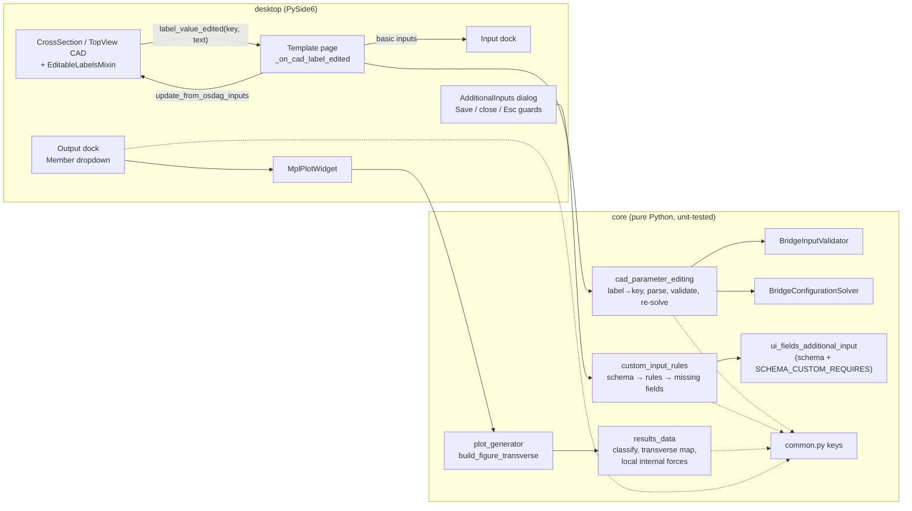
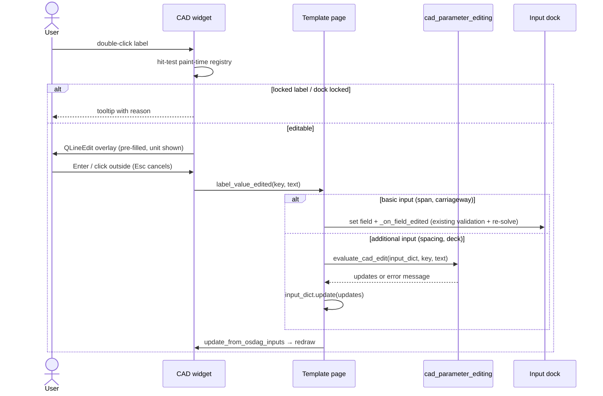
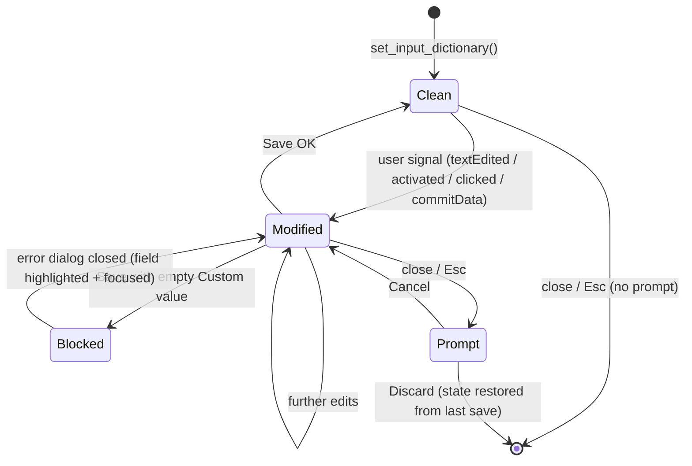
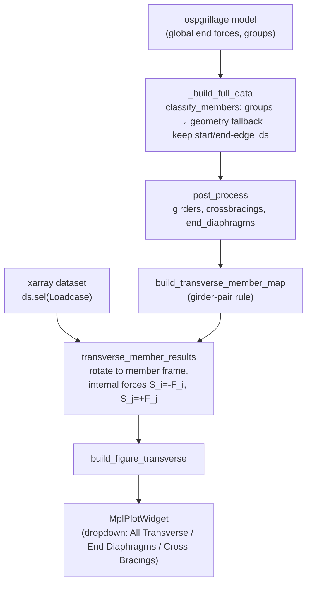

# 04 — System Design

## 4.1 Alternatives considered

### Task I — how to make painted labels clickable

| Approach | Feasibility | Cost | Risk | Decision |
|---|---|---|---|---|
| A. Replace painted labels with child `QLabel` widgets | Requires re-layout on every zoom/resize, duplicates text-placement logic in two 1 500–2 900-line widgets | High | Visual regressions | Rejected |
| B. Port the CAD to `QGraphicsScene` (items are natively hit-testable) | Rewrite of both CAD widgets | Very high | High | Rejected (out of scope) |
| **C. Paint-time hit-test registry** (record each label's rect while painting; hit-test on double-click; overlay a `QLineEdit`) | One hook in the shared `draw_text_with_background` | Low | Rects always match what is drawn (recomputed every frame, so zoom/scroll are free) | **Chosen** |

Derived-label semantics: (a) *solve* for upstream parameters (Cascaval et al. 2022 style),
(b) prompt the user to choose which parameter absorbs the change, (c) **lock**. The
assignment mandates (c). For editable *girder spacing* we hold *n* fixed and derive the
overhang, which is the existing `BridgeConfigurationSolver` contract.

### Task II — where the "Custom requires a value" knowledge lives

| Approach | Decision |
|---|---|
| Hard-code a list of widget names in the dialog | Rejected — prohibited by the task; drifts from the schema |
| Infer at runtime ("any empty enabled field near a Custom combo") | Rejected — implicit and unpredictable |
| **Derive from the schema**: mode-line pairs automatically, combo dependencies declared with `SCHEMA_CUSTOM_REQUIRES: [KEY_…]`, adaptive design-mode textboxes automatically | **Chosen** |

Dirty tracking: (a) set the flag in `_update_input_dict` (also fires on programmatic
refreshes → false warnings); (b) snapshot-diff the dict at close (misses widget-only state,
expensive for nested dicts); (c) **user-only Qt signals** (`textEdited`, `activated`,
`clicked`, delegate `commitData`) plus explicit marks in custom-widget callbacks →
**chosen**, and measured to give no false positive on open/close (E2).

### Task III — what quantity to plot

| Approach | Decision |
|---|---|
| Plot raw global components (reuse girder path) | Rejected — mislabels quantities (E4) |
| Request `get_results(local_forces=True)` | Rejected — would change the dataset used by every existing consumer; OpenSees' local y/z are opposite to the UI convention (E3 sign pattern [1, −1, −1]) |
| **Rotate global end forces per member into a frame that equals global for girders; convert to internal forces** | **Chosen** — girder plots unchanged, transverse plots correct, verified against OpenSees |

## 4.2 Architecture

## 4.3 Task I sequence

## 4.4 Task II state machine

## 4.5 Task III data flow

Local frame for a horizontal member from node *i* to *j*:
$e_x = (x_j - x_i)/L$, $e_y = \hat Y$ (vertical), $e_z = e_x \times e_y$;
$\mathbf F^{loc} = R\,\mathbf F^{glob}$ with $R = [e_x; e_y; e_z]$, applied to the force and
moment triplets at each end. For a girder along +X, $R = I$.

## 4.6 Interfaces (new public functions)

| Module | Function | Contract |
|---|---|---|
| `core/.../cad_parameter_editing.py` | `classify_label(text) → CadLabelSpec \| None` | maps painted caption to central key |
| | `evaluate_cad_edit(input_dict, key, text) → EditResult` | pure; never mutates input |
| `core/.../custom_input_rules.py` | `extract_custom_rules(schema)`, `find_empty_custom_fields(rules, state)`, `format_errors(missing)` | pure; exact message format |
| `core/.../results_data.py` | `classify_members`, `build_transverse_member_map`, `member_local_axes`, `member_internal_forces`, `transverse_member_results` | pure; SI → kN/kN·m/mm |
| `core/.../plot_generator.py` | `build_figure_transverse(ds, key, nodes, members, map, selection, …)` | returns `(Figure, summary)` like existing builders |

## 4.7 Error handling

* Non-finite, non-numeric, ≤ 0, out-of-range or infeasible CAD values → `Critical` dialog
  with the validator/solver message; dictionaries untouched.
* Empty custom values → Save halted; every missing field listed; first one revealed.
* Message box closed via its title bar → treated as **Cancel** (safe default).
* Transverse selection with no members (e.g. a model with no girder pairs) → explicit
  "No transverse members" note in the figure.

## 4.8 Testing strategy

* **Unit (pytest, no display):** label mapping, parsing, validation, solver invariants
  (width equation), rule extraction over the real schema, message format, member
  classification, local axes, internal-force mapping, transverse map.
* **End-to-end (real window, scripted):** `screening_task/experiments/e2e_task*.py`.
* **Oracle check:** rotation vs OpenSees `localForces` (E3).
