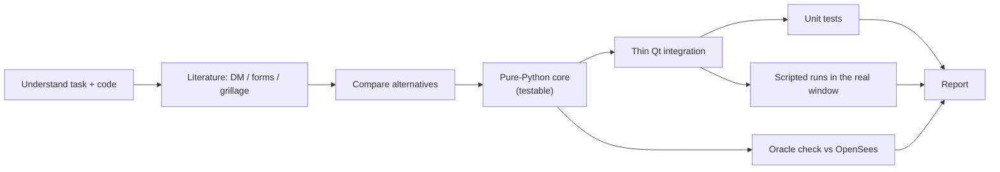
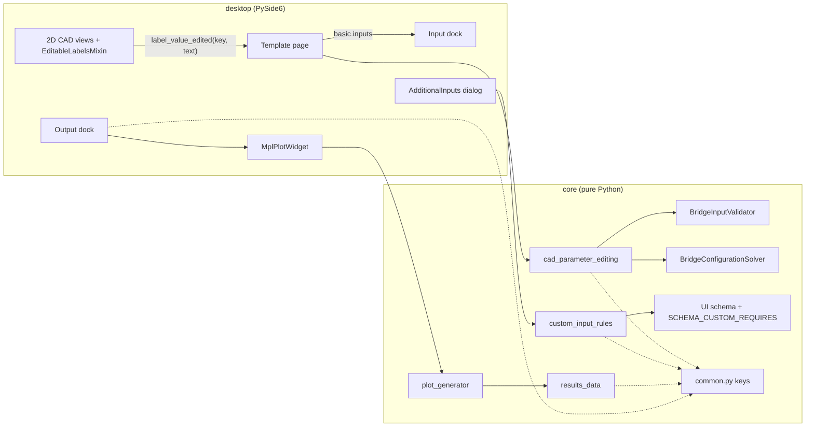
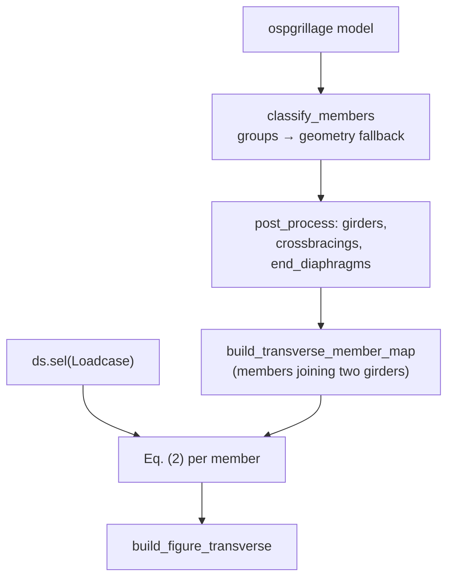
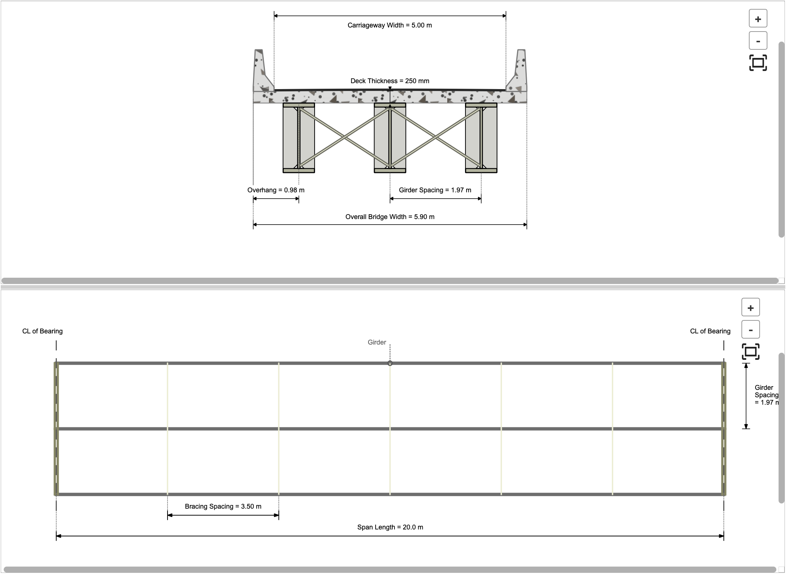
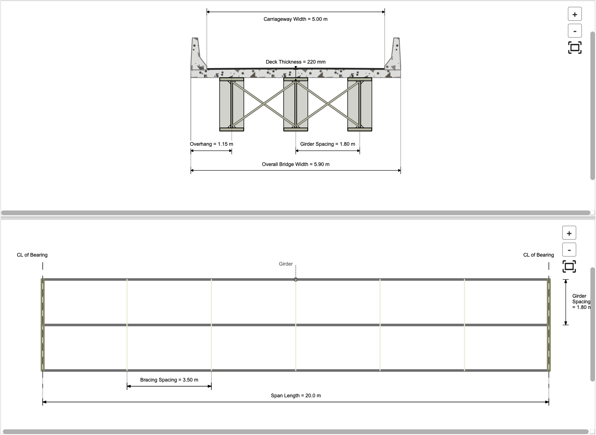
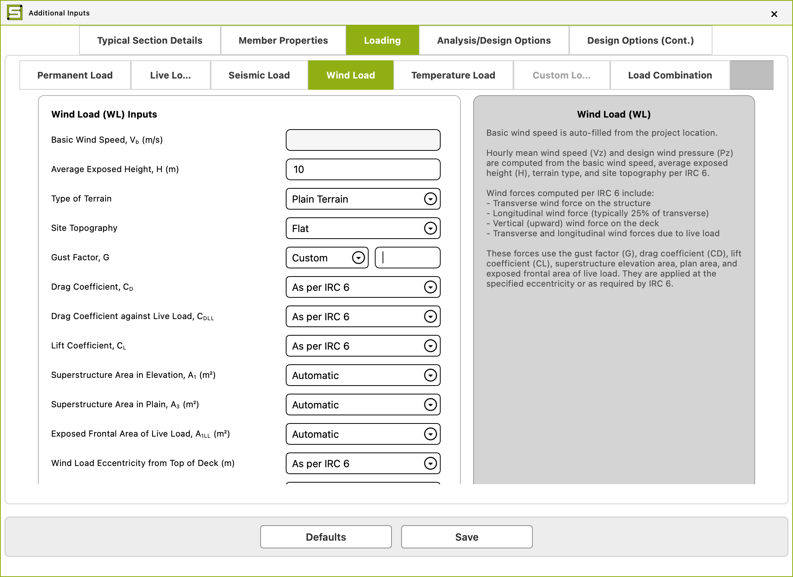
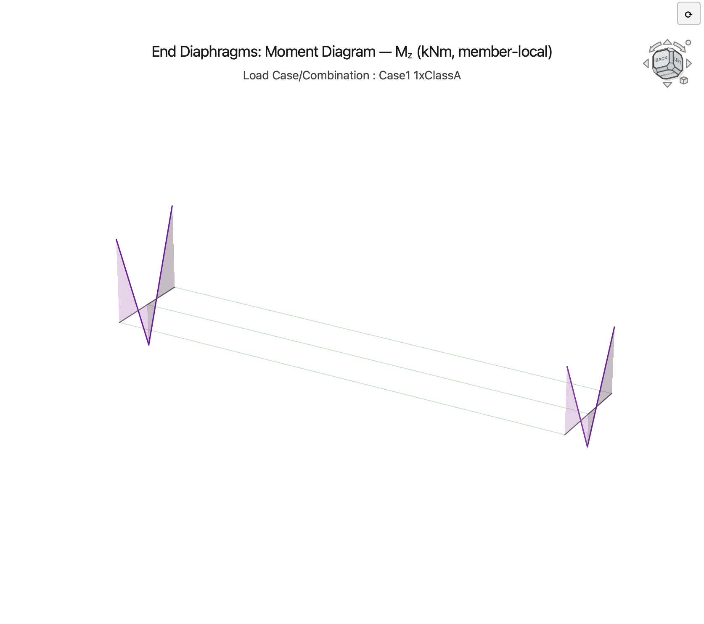
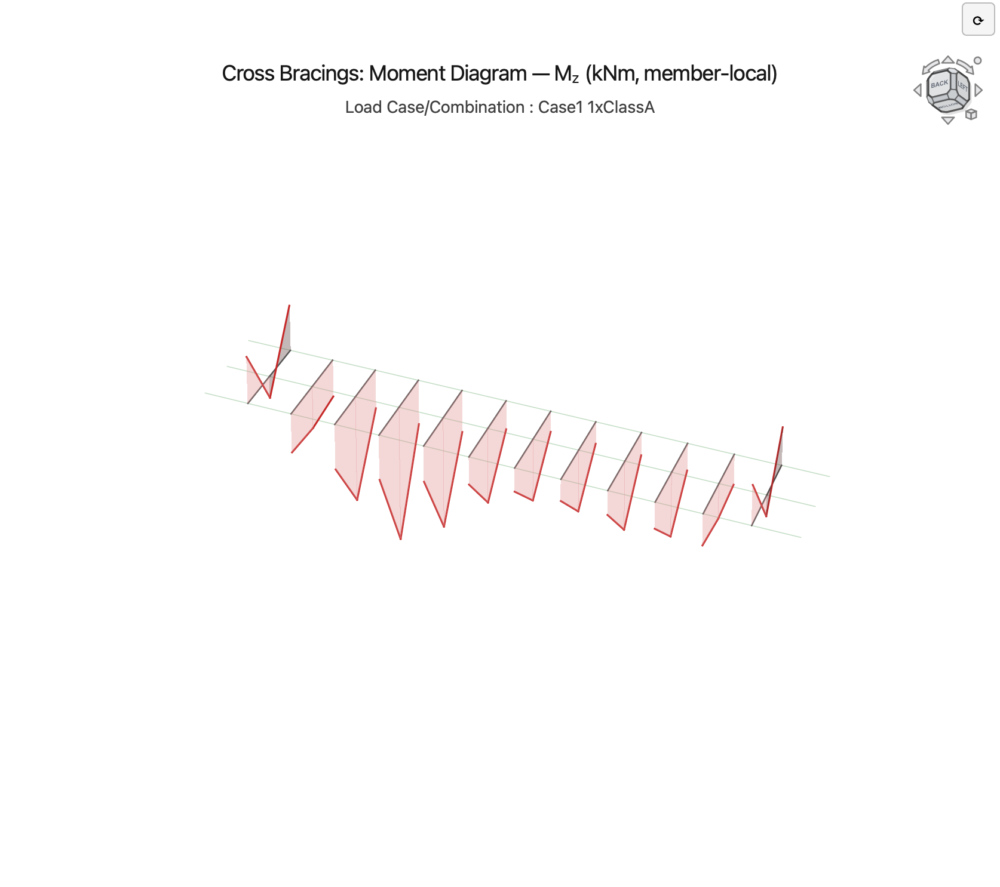

# Direct, Validated and Correctly-Labelled
## UI, 2D CAD and Transverse-Member Plotting Enhancements for OsdagBridge

*FOSSEE Osdag Winter Internship 2026 — Screening Task Report*
*Track: Software Development — "OsdagBridge UI, 2D CAD, and Plotting Enhancements"*
*Code: branch `screening-task/ui-2dcad-plotting` of the OsdagBridge fork (base `dev@d74f56d`)*
*Date: 23 November 2026*

---

## Abstract

OsdagBridge analyses short-span steel plate-girder bridges with an OpenSeesPy grillage and
presents inputs and results in a PySide6 desktop interface. This report describes three
enhancements requested by the Osdag team and the reasoning behind each. First, dimension
labels painted on the 2D CAD can be double-clicked and edited in place. Derived dimensions
are locked, because editing them is an under-determined inverse problem. Every edit passes
through the same validator and girder-layout solver as the input forms. Second, the
Additional Inputs dialog refuses to save while any active "Custom" selection has an empty
value, and it warns before unsaved edits are discarded. The rules are derived from the UI
schema rather than hard-coded. Third, transverse members (end diaphragms and intermediate
cross-bracing) can be selected and plotted for all nine response components. While
implementing this we found that the solver returns *global* end forces, which coincide with
the plots' member-local labels only for girders. Reusing the girder path for transverse
members would have shown a 62.4 kN·m bending moment as ≈ 0 and reported it as torsion
instead. We transform forces into member axes; the transformation matches OpenSees' own
local forces to 1.5 × 10⁻¹¹ N on all 93 checked elements, including a 15° skew. The work
is covered by 46 new unit tests and scripted end-to-end runs in the real application.

---

## 1. Introduction

The Osdag screening task asks for three concrete changes to OsdagBridge's desktop UI:
interactive editing on the 2D CAD (Task I), validation and state management in the Additional
Inputs dialog (Task II), and result plots for transverse members (Task III). Each task
looks small on paper. In this codebase, each one sits where two representations of the
same information meet:

* the **drawing** and the **input dictionaries** (Task I),
* the **widgets** and the **saved state** (Task II),
* the **solver's coordinate system** and the **engineer's vocabulary** (Task III).

Bugs at these junctions are silent. Nothing crashes; the user simply sees or saves something
other than what they intended. The guiding objective of this work was therefore to make each
junction **explicit, single-sourced and testable**. We treated it as a small research
exercise: understand the problem, consult the relevant literature, compare alternatives,
implement, and gather evidence.

## 2. Background and Motivation

**OsdagBridge architecture.** The template page holds an *input dock* (basic inputs: span,
carriageway width, etc.), a central canvas (2D CAD as cross-section and plan views, 3D CAD, or
result plots) and an *output dock*. A single `input_dict` on the template page is shared, by
reference, with the Additional Inputs dialog. `BridgeConfigurationSolver` enforces the
girder-layout equation

$$ W = (n-1)\,s + 2\,o \qquad (1)$$

where *W* is the overall width (derived from carriageway, barrier, footpath, railing and
median widths), *n* the girder count, *s* the girder spacing and *o* the deck overhang.
Analysis uses ospgrillage (Ngan & Caprani, 2022) on OpenSeesPy (Zhu et al., 2018).

**Why these tasks matter.**
*Task I:* changing a dimension visible on the drawing currently requires finding its field,
which for girder spacing lives in a separate dialog. Direct manipulation (Shneiderman, 1983)
removes that indirection. *Task II:* today an empty "Custom" field is silently replaced by a
default (`_update_input_dict`), contradicting the user's explicit choice, and closing the
dialog drops edits without notice. *Task III:* transverse members are designed by
OsdagBridge, yet their forces cannot be inspected. The steel-bridge literature singles out
cross-frame forces from simplified models as sensitive to modelling and post-processing
(White et al., 2012; Reichenbach et al., 2021).

## 3. Problem Statement

Given the existing OsdagBridge `dev` code base:

1. Make the template-page CAD labels *Carriageway Width, Girder Spacing, Deck Thickness, Span
   Length* editable by double-click, with validation, propagation to the input dictionaries
   and a redraw. *Overhang, Overall Bridge Width, Bracing Spacing* must stay read-only.
2. In Additional Inputs, halt *Save* when any active "Custom" selection has an empty value
   (message: `Error: The custom value for '[Parameter Name]' cannot be empty.`). Track
   `is_modified` and warn on close (*Discard / Cancel*). Use central keys only.
3. Add transverse members to the plot member selector and plot Fx, Vy, Vz, Tx, My, Mz, Dx, Dy,
   Dz per load case, with extraction routed through `results_data.py` and an accurate
   longitudinal/transverse element mapping.

## 4. Objectives and Scope

**Objectives.** (O1) meet every explicit requirement; (O2) keep one source of truth for
validation, layout and keys; (O3) avoid regressions in existing behaviour; (O4) provide
evidence for each claim.
**Out of scope.** Redesigning the CAD rendering, changing the analysis model, and splitting
cross-frame equivalent-beam forces into diagonals and chords (explicitly not required).

## 5. Related Work

Full summaries and access levels are in `docs/02_literature_review.md`. We state openly
which sources were read in full: Cascaval et al. (2022) and Ngan & Caprani (2022) in full;
Hempel et al. (2019) and Gonzalez et al. (2023) in part; the remaining sources at
abstract/record level only.

**Direct manipulation and bidirectional editing.** Shneiderman (1983) and Hutchins, Hollan &
Norman (1985) describe why acting on the visible object reduces the distance between
intention and action. Bidirectional programming systems extend this to parametric models.
Sketch-n-Sketch (Hempel, Lubin & Chugh, 2019) rewrites program constants from canvas edits,
ranks candidate rewrites and lets users *freeze* constants. Cascaval et al. (2022) resolve
edits of 3-D CAD output by constrained optimisation over program parameters, always fixing
integer parameters. They report that ambiguity is handled only heuristically and that users
wanted explanations for infeasible edits. Gonzalez et al. (2023) face the same choice of
"which variable to change" in OpenSCAD. Bettig & Hoffmann (2011) survey geometric
constraint solving in parametric CAD.

**Error prevention in forms.** Nielsen (1994) lists *error prevention* among usability
heuristics derived from 249 catalogued problems. Seckler et al. (2014) show in a controlled
study (N = 65) that forms applying explicit guidelines are completed faster and with fewer
submission attempts.

**Grillage analysis.** Hambly (1991) is the classic reference on bridge-deck behaviour
and simplified deck models. ospgrillage automates grillage generation on OpenSeesPy. NCHRP
Report 725 compared 1D, 2D and 3D analyses of 60 I-girder bridges, and its summary reports
that 2D grids can give noticeably erroneous results in some categories, partly due to how
cross-frames are represented. NCHRP Research Report 962 field-tested three bridges and
reports high variability of load-induced cross-frame forces and errors introduced when
equivalent-beam forces are post-processed.

## 6. Engineering Gaps Addressed

This is an engineering task, so we do not claim new science. We address three concrete gaps
(details in `docs/03_research_gap_and_proposed_approach.md`):

* **G1 (Task I).** General bidirectional editors leave the editing of *derived* values
  ambiguous. Here the dependency (Eq. 1) is known exactly, so ambiguity can be removed by
  design: lock *W* and *o*, and route *s* through the domain solver with *n* fixed. This is
  the same choice Cascaval et al. make for integer parameters.
* **G2 (Task II).** No validation exists on Save; empty Custom values are silently replaced;
  `Esc` closes the dialog without any close event (Qt `reject()`).
* **G3 (Task III).** Global solver components are shown under member-local labels. This is
  harmless for girders along X, but wrong for members along Z. Member classification is
  purely geometric, and end-diaphragm groups are discarded before plotting.

## 7. Proposed Methodology



Each task is split into a **pure-Python core** (no Qt imports; unit-testable) and a **thin Qt
layer** that adapts widgets to the core. Validation, layout solving and key definitions are
reused, never duplicated. Alternatives considered for each task are tabulated in
`docs/04_system_design.md`. The decisive comparisons are summarised below.

| Decision | Alternatives | Chosen because |
|---|---|---|
| Make painted labels clickable | child QLabels; QGraphicsScene port; **paint-time hit-test registry** | One hook; rectangles always equal what is drawn, at any zoom |
| Where "Custom needs a value" lives | hard-coded list; runtime inference; **schema-derived rules** | Required by the task (keys only); cannot drift from the UI |
| Detect unsaved edits | flag in dict writer; dict snapshot diff; **user-only Qt signals** | No false positives from programmatic refreshes (measured) |
| Transverse force quantity | raw global; OpenSees `localForces`; **rotated global, frame = global for girders** | Correct labels and signs consistent with existing girder plots (E3, E4) |

## 8. System Architecture



## 9. Algorithmic Design

### 9.1 Task I — label hit-testing and edit evaluation

During every `paintEvent` the shared `draw_text_with_background` records `(rect, spec)` for
any text whose caption maps to a parameter (`classify_label`). A double-click hit-tests the
registry topmost-first. Editable specs open a `QLineEdit` overlay pre-filled in the label's
unit; locked specs show their reason. On commit:

```text
evaluate_cad_edit(input_dict, key, text):
    v ← parse finite float (reject '', junk, nan, ±inf); require v > 0
    run BridgeInputValidator (basic or additional) on a copy with key = v
    if key = girder spacing:
        (s, o, W, n) ← BridgeConfigurationSolver._solve_layout(n fixed, s = v, "spacing")
        return {s, o, W, n}                       # Eq. (1) holds by construction
    return {key: v}
```

Basic inputs (span, carriageway) are written into the input-dock field and handed to the
dock's own handler, so CAD edits and field edits behave identically.

### 9.2 Task II — schema-derived rules

`extract_custom_rules` walks the Additional Inputs schema and produces rules
`(selector, required field, label)` from three patterns:
(a) every mode-line field with a "Custom" choice (`<id>.mode` → `<id>.value`);
(b) every combo box declaring `SCHEMA_CUSTOM_REQUIRES: [KEY_…]`;
(c) every adaptive field whose "Custom" design-mode variant is a text box.
At Save, a rule fires iff its selector reads `VALUE_CUSTOM`, the selector and the field are
**active**, and the field is empty. A widget is active iff every enclosing tab is
*enabled* and no other ancestor is explicitly hidden. Visibility cannot be used, because
`QStackedWidget` hides non-current tab pages.

### 9.3 Task III — member-local internal forces

For a member from node *i* to *j*: $e_x = (\mathbf x_j - \mathbf x_i)/L$, $e_y = \hat Y$,
$e_z = e_x \times e_y$, $R = [e_x; e_y; e_z]$. With ospgrillage's global end forces
$\mathbf f_e, \mathbf m_e$ at end *e*:

$$ \mathbf s_i = -R\,\mathbf f_i,\;\; \mathbf s_j = +R\,\mathbf f_j \quad(\text{same for } \mathbf m) \qquad (2)$$

For a girder along +X, *R = I*, so existing girder plots are unchanged. For a transverse
member along +Z, $e_z = -\hat X$: the member's bending moment $M_z$ comes from global
$-M_x$, and its torsion $T_x$ from global $M_z$.



Members are classified by **ospgrillage group membership first**, because groups record how
the model was built. Geometry (same Y and Z ⇒ longitudinal) is only a fallback. The
fallback is necessary: in OsdagBridge models one edge beam belongs to no group (E3).

## 10. Implementation

Production changes: 15 files, ≈ 980 lines added, 22 removed (three commits, one per task).
New modules: `cad_parameter_editing.py`, `custom_input_rules.py` (core) and
`cad_label_editing.py` (desktop). New keys in `common.py`: `VALUE_CUSTOM`,
`SCHEMA_CUSTOM_REQUIRES`, and the three transverse dropdown values with their mapping. File-
by-file details are in `docs/06_implementation_details.md`. Notable details:

* The editor commits on Enter **or** focus-out. Qt emits both `returnPressed` and
  `editingFinished`, so a re-entrancy guard prevents double commits. The emit is deferred so
  that any error dialog appears after the editor has gone.
* Before applying an additional-input edit, the template page runs the pending
  required-field re-solve. Without this, the next re-solve would overwrite the user's edit.
* **Discard** restores the dialog from the last saved dictionary, because at least one
  compute function (`compute_railing_values`) reads widget state at design time.
* Camera angles are kept only within a plot family. Transverse members run across the width
  and are unreadable in the girders' front elevation.

## 11. Experimental Setup

Apple M4 (16 GB), macOS 27.0.1, Python 3.12.16, PySide6 6.9.3, matplotlib 3.11.2, openseespy
3.8.0.0, osdag 2026.04.0.0. Fixture bridge: span 20 m, carriageway 5 m (3 girders,
s = 1.97 m, o = 0.98 m, W = 5.90 m), skew 0° and 15°. The location was entered via the
dialog's custom-data form (Vb = 44 m/s, zone III); this is a test fixture, not a design case.
Experiments drive the **real** template page through `QTest` events (no mocks of the code
under test; only modal message boxes are intercepted to record their content).

## 12. Results and Analysis

**Task I (E1).** Figure 1 shows the CAD before and Figure 2 after two double-click edits.





| Edit | Outcome |
|---|---|
| Spacing 1.80 m (cross-section) | s = 1.80, o = 1.15, W = 5.90, n = 3; Eq. (1) exact |
| Spacing 2.2 m (plan view, after W = 8.4) | o = 2.00; 2×2.2 + 2×2.0 = 8.4 |
| Deck 220 mm | applied |
| Carriageway 7.5 m, span 30 m | applied via input dock; layout re-solved (s = 2.80, W = 8.40) |
| Deck 50 mm / spacing 99 m | rejected with validator message; unchanged |
| Overhang, overall width, any label while dock locked | editor not opened; reason shown |
| Esc | cancelled; unchanged |

**Task II (E2).** No warning on a clean open/close; Save blocked with the exact message for
each empty field; Save succeeds after filling; Cancel keeps the dialog open; *Esc* is
intercepted; Discard closes and restores 250 mm in both dictionary and widget (Figure 3).



**Task III (E3–E5).** Classification: groups and geometry agree on all 108 grouped elements;
13 ungrouped elements (the second edge beam) are recovered by geometry; 4 end-diaphragm and 24
cross-bracing elements join girder pairs. Eq. (2) against OpenSees `localForces`:

| Skew | Members | Max. abs. error | Peak force |
|---|---|---|---|
| 0° | 65 longitudinal / 4 ED / 24 CB | 0.0 N | 4.9 × 10⁵ N |
| 15° | 65 / 4 / 24 | ≤ 1.5 × 10⁻¹¹ N | 4.9 × 10⁵ N |

OpenSees' own local y and z axes are opposite to the UI convention (sign pattern
[1, −1, −1]), so using `localForces` directly would invert shears and moments relative to
the girder plots.





All 54 renders (2 load cases × 3 selections × 9 components) succeeded at each skew; the time
from selection to rendered canvas was ≈ 143 ms median and ≤ 292 ms maximum, including a
fixed 50 ms harness wait. Dead-load results are physically consistent: the two end-diaphragm
bays give identical Mz (62.41 / −31.21 kN·m), shears are antisymmetric (±46.42 kN), and
vertical displacement on the support lines is zero.

## 13. Comparative Evaluation

The meaningful baseline for Task III is the *naive* implementation: reuse the girder path
(raw global components) for transverse members (E4, peak over 28 members).

| Component | 1.0 DL proposed | 1.0 DL naive | Class A proposed | Class A naive |
|---|---|---|---|---|
| Vy (kN) | 46.42 | 46.42 | 32.96 | 32.96 |
| Tx (kN·m) | 0.001 | **62.41** | 0.001 | **45.74** |
| Mz (kN·m) | **62.41** | 0.001 | **45.74** | 0.001 |
| Fx, Vz, My | 0 | 0 | 0 | 0 |

The naive plot would tell an engineer that diaphragms carry no bending and large torsion.
For Tasks I and II the baseline is the unmodified `dev` behaviour, which offers no CAD
editing, saves empty custom values silently, and closes without warning. We did not run a
user study, so usability improvements are argued from the literature rather than measured.

## 14. Limitations and Challenges

* **Single fixture geometry** in end-to-end runs (3 girders); 2-girder and no-overhang cases
  are covered by unit tests only.
* **Existing reset behaviour:** a basic-input change (on the CAD or in the dock) re-applies
  typical-section defaults, discarding a custom deck thickness. This is preserved and
  documented, not changed.
* **Equivalent-beam forces:** cross-frame plots show the grillage's equivalent beam, as
  permitted; NCHRP 962 warns that interpreting these as member forces needs care.
* **Validator NaN gap:** `BridgeInputValidator` accepts `"nan"`; only the CAD path guards
  against it.
* **Error highlight:** the dialog sets the existing `error` property, but its stylesheet has
  no rule for it, so the visible cue is the tab switch and focus, not a red border.
* **Environment:** on macOS arm64, `environment.yml` alone does not produce a runnable app
  (old `osdag` package with PyQt5; PySide6, navcube, mplcursors, ifcopenshell, openpyxl,
  plotly missing; `osdag_latex_env` unavailable). Report generation was not tested.
* **Literature access:** NCHRP texts and Nielsen (1994) were available only at summary level.

## 15. Future Work

Fix the validator for non-finite values; complete `environment.yml`; run the end-to-end
scripts in CI with pytest-qt over several girder counts; preserve user-set additional
inputs on basic edits; undo/redo and keyboard access for CAD labels; an optional
diagonal/chord view using the existing `CrossBracingForces`; a chooser for editing derived
labels; and a comparison of grillage transverse forces against 3-D shell models for
selected bridges. A prioritised roadmap is in `docs/08_final_implementation_roadmap.md`.

## 16. Conclusion

All three requested features are implemented and verified in the running application. The
common thread is that each task sits where two representations of the same data meet, and
each was solved by giving that junction one explicit, tested definition. CAD labels map to
central keys and reuse the forms' validator and solver. "Custom requires a value" is derived
from the UI schema. Plotted quantities are transformed into member axes, with the
transformation checked against OpenSees. The most consequential finding was not part of the
brief: without the transformation, transverse-member plots would have shown bending as
torsion. Experiments like E3 and E4 are cheap to run and catch exactly this class of silent
error.

## References

1. Bettig, B., & Hoffmann, C. M. (2011). Geometric constraint solving in parametric computer-aided design. *Journal of Computing and Information Science in Engineering*, 11(2). https://doi.org/10.1115/1.3593408
2. Cascaval, D., Shalah, M., Quinn, P., Bodik, R., Agrawala, M., & Schulz, A. (2022). Differentiable 3D CAD programs for bidirectional editing. *Computer Graphics Forum*, 41(2), 309–323. https://doi.org/10.1111/cgf.14476
3. Gonzalez, J. F., Kieken, D., Pietrzak, T., Girouard, A., & Casiez, G. (2023). Introducing bidirectional programming in constructive solid geometry-based CAD. *Proc. ACM Symposium on Spatial User Interaction (SUI '23)*. https://doi.org/10.1145/3607822.3614521
4. Hambly, E. C. (1991). *Bridge Deck Behaviour* (2nd ed.). E & FN Spon. ISBN 0-419-17260-2.
5. Hempel, B., Lubin, J., & Chugh, R. (2019). Sketch-n-Sketch: Output-directed programming for SVG. *Proc. UIST 2019*. https://doi.org/10.1145/3332165.3347925
6. Hutchins, E. L., Hollan, J. D., & Norman, D. A. (1985). Direct manipulation interfaces. *Human–Computer Interaction*, 1(4), 311–338. https://doi.org/10.1207/s15327051hci0104_2
7. Ngan, J. W., & Caprani, C. C. (2022). ospgrillage: A bridge deck grillage analysis preprocessor for OpenSeesPy. *Journal of Open Source Software*, 7(77), 4404. https://doi.org/10.21105/joss.04404
8. Nielsen, J. (1994). Enhancing the explanatory power of usability heuristics. *Proc. CHI '94*, 152–158. https://doi.org/10.1145/191666.191729
9. Reichenbach, M., et al. (2021). *Proposed Modification to AASHTO Cross-Frame Analysis and Design* (NCHRP Research Report 962). Transportation Research Board. https://doi.org/10.17226/26074
10. Seckler, M., Heinz, S., Bargas-Avila, J. A., Opwis, K., & Tuch, A. N. (2014). Designing usable web forms: Empirical evaluation of web form improvement guidelines. *Proc. CHI 2014*, 1275–1284.
11. Shneiderman, B. (1983). Direct manipulation: A step beyond programming languages. *Computer*, 16(8), 57–69. https://doi.org/10.1109/MC.1983.1654471
12. White, D. W., et al. (2012). *Guidelines for Analysis Methods and Construction Engineering of Curved and Skewed Steel Girder Bridges* (NCHRP Report 725). Transportation Research Board. https://doi.org/10.17226/22729
13. Zhu, M., McKenna, F., & Scott, M. H. (2018). OpenSeesPy: Python library for the OpenSees finite element framework. *SoftwareX*, 7, 6–11. https://doi.org/10.1016/j.softx.2017.10.009

## Appendix A — Reproducing the results

```bash
conda activate osdagbridge-env
pytest -q tests/unit                                   # 48 tests
export QT_PLUGIN_PATH=$(python -c "import PySide6,os;print(os.path.join(os.path.dirname(PySide6.__file__),'Qt','plugins'))")
python screening_task/experiments/e2e_task1_cad_editing.py
python screening_task/experiments/e2e_task2_additional_inputs.py
python screening_task/experiments/e2e_task3_transverse_plots.py 15
python screening_task/experiments/verify_local_force_transform.py 15
python screening_task/experiments/E4_naive_vs_local.py
```

Raw outputs: `screening_task/experiments/results/` (JSON + PNG).

## Appendix B — Files changed

`core/utils/common.py`, `core/bridge_types/plate_girder/{cad_parameter_editing.py (new),
custom_input_rules.py (new), ui_fields_additional_input.py, results_data.py,
results_data_post_processing.py, plot_generator.py, plategirderbridge.py}`,
`desktop/ui/docks/{cad_label_editing.py (new), cad_cross_section.py, cad_top_view.py,
output_dock.py}`, `desktop/ui/{template_page.py, mpl_plot_widget.py}`,
`desktop/ui/dialogs/additional_input/additional_inputs.py`; tests in `tests/unit/`.
